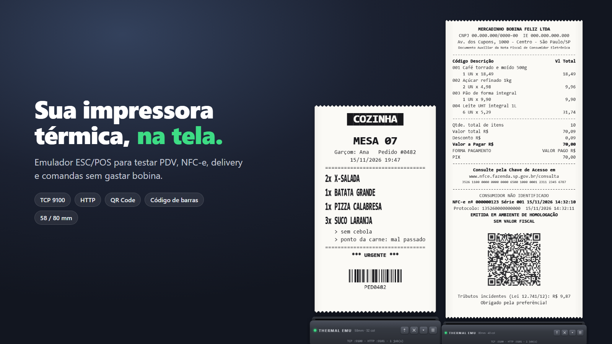
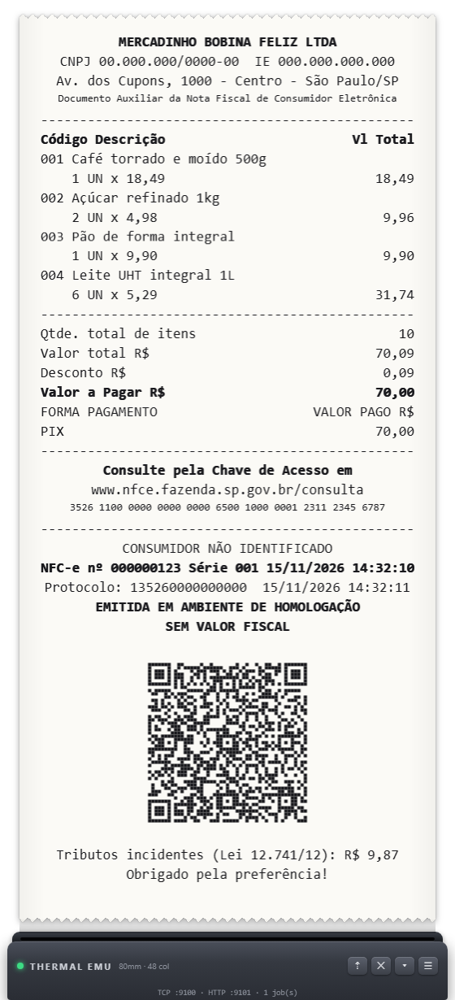
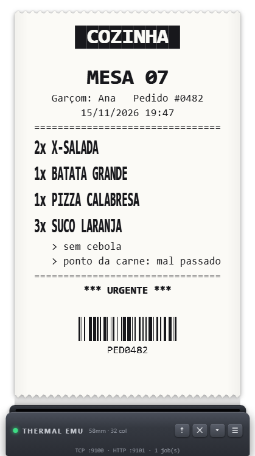
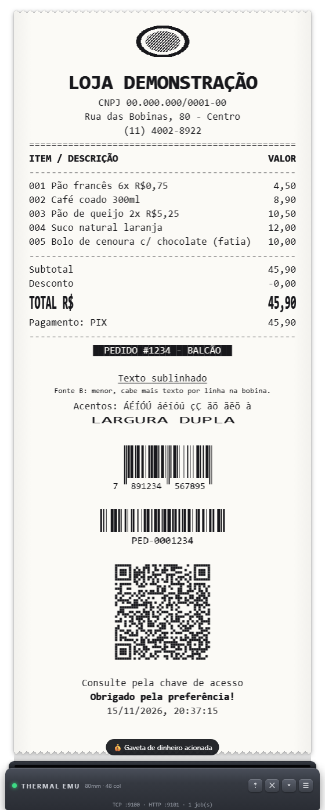

<p align="center">
  
</p>

<h1 align="center">Emulador de Impressora Térmica ESC/POS</h1>

<p align="center">
  <b>Teste a impressão do seu PDV, NFC-e, delivery ou comanda sem impressora e sem gastar bobina.</b><br>
  Uma impressora térmica virtual que fica no canto da tela, com o papel subindo de verdade a cada impressão.
</p>

<p align="center">
  <a href="https://github.com/prefeitojordan/emulador-impressora-termica/releases/latest"></a>
  
  
</p>

---

<table>
<tr>
<td width="340" valign="top"></td>
<td valign="top">

### Por que usar

Quem desenvolve sistema que imprime conhece a rotina: imprime, levanta, olha o papel, ajusta uma coluna, imprime de novo. Isso quando tem impressora por perto.

Com o emulador, **o cupom aparece na hora no canto da sua tela**, igual à impressora real:

- 🖨️ **Seu sistema não muda nada.** Ele imprime na porta **9100** como numa impressora de rede, ou pela API HTTP.
- 🔍 **Os erros aparecem.** Acentos com a página de código errada saem errados, linhas que passam de 48 colunas quebram, e um código de barras inválido aparece **em vermelho**.
- ✂️ **Comportamento de impressora de verdade:** corte com picote, aviso de gaveta, bip e resposta de status (`DLE EOT`).
- 📋 **Clique com o botão direito no cupom** para copiar o texto ou salvar como PNG e anexar no chamado ou na documentação.

**[⬇️ Baixar para Windows](https://github.com/prefeitojordan/emulador-impressora-termica/releases/latest)**: tem instalador ou versão portátil, sem precisar de Node.

</td>
</tr>
</table>

## 📸 Exemplos

| NFC-e (80 mm) | Comanda de cozinha (58 mm) | Página de teste (80 mm) |
|:---:|:---:|:---:|
|  |  |  |
| QR Code da Sefaz, chave de acesso, fonte B | Texto grande, invertido, CODE128 | Logo raster, estilos, EAN-13, acentos |

> Todas as imagens acima foram renderizadas pelo próprio emulador a partir de bytes ESC/POS, com dados fictícios. Para gerar de novo: `npx electron tools/capture.js`.

## 🚀 Começando em 1 minuto

1. Baixe e abra o emulador ([Releases](https://github.com/prefeitojordan/emulador-impressora-termica/releases/latest)). A impressora aparece no canto inferior direito.
2. No seu sistema, configure uma impressora **de rede** com IP `127.0.0.1` e porta `9100`.
3. Imprima. Pronto. 🎉

Quer testar antes? Clique no ícone da bandeja (ou no botão **☰** da impressora) e escolha **Imprimir página de teste**.

## 🔌 Integração

O emulador entende **ESC/POS padrão Epson**, então funciona com as bibliotecas que você já usa.

<details open>
<summary><b>Python</b> (<code>python-escpos</code>)</summary>

```python
from escpos.printer import Network

p = Network("127.0.0.1")          # porta 9100
p.set(align="center", bold=True, double_height=True)
p.text("PEDIDO #42\n")
p.set()
p.qr("https://exemplo.com.br/pedido/42", size=6)
p.cut()
```
</details>

<details>
<summary><b>Node.js</b> (<code>node-thermal-printer</code>)</summary>

```js
const { ThermalPrinter, PrinterTypes } = require('node-thermal-printer');

const printer = new ThermalPrinter({ type: PrinterTypes.EPSON, interface: 'tcp://127.0.0.1:9100' });
printer.alignCenter();
printer.bold(true);
printer.println('PEDIDO #42');
printer.bold(false);
printer.printQR('https://exemplo.com.br/pedido/42');
printer.cut();
await printer.execute();
```
</details>

<details>
<summary><b>PHP</b> (<code>mike42/escpos-php</code>)</summary>

```php
use Mike42\Escpos\Printer;
use Mike42\Escpos\PrintConnectors\NetworkPrintConnector;

$printer = new Printer(new NetworkPrintConnector("127.0.0.1", 9100));
$printer->setJustification(Printer::JUSTIFY_CENTER);
$printer->text("PEDIDO #42\n");
$printer->qrCode("https://exemplo.com.br/pedido/42");
$printer->cut();
$printer->close();
```
</details>

<details>
<summary><b>C# / .NET</b> (socket direto)</summary>

```csharp
using System.Net.Sockets;
using System.Text;

Encoding.RegisterProvider(CodePagesEncodingProvider.Instance);
var cp850 = Encoding.GetEncoding(850);
var bytes = new List<byte> { 0x1B, 0x40, 0x1B, 0x74, 0x02 };   // ESC @, ESC t 2 (CP850)
bytes.AddRange(cp850.GetBytes("Pedido #42 - Café e pão\n\n\n"));
bytes.AddRange(new byte[] { 0x1D, 0x56, 0x42, 0x00 });          // corte parcial

using var tcp = new TcpClient("127.0.0.1", 9100);
tcp.GetStream().Write(bytes.ToArray());
```
</details>

<details>
<summary><b>Sistema web</b> (HTTP, direto do navegador)</summary>

```js
// texto simples (UTF-8), com corte no final
await fetch('http://localhost:9101/print', {
  method: 'POST',
  headers: { 'Content-Type': 'application/json' },
  body: JSON.stringify({ text: 'PEDIDO #42\nX-Salada ......... R$ 25,00\n\n' }),
});

// ou bytes ESC/POS gerados pelo seu sistema
await fetch('http://localhost:9101/print', { method: 'POST', body: bytesEscPos });
```
</details>

<details>
<summary><b>Pelo nome da impressora no Windows</b> (spooler)</summary>

Para sistemas que imprimem em "uma impressora do Windows", rode **como Administrador**:

```powershell
powershell -ExecutionPolicy Bypass -File .\exemplos\instalar-impressora-windows.ps1
```

Isso cria a impressora **"Impressora Termica Emulada"** (driver *Generic / Text Only*, porta RAW `127.0.0.1:9100`).
</details>

### Endereços

| Forma | Endereço | Detalhes |
|---|---|---|
| **TCP RAW / JetDirect** | `127.0.0.1:9100` | Abre o socket, manda os bytes e fecha. Cada conexão é um job. Responde status no mesmo socket. |
| **HTTP** | `POST http://localhost:9101/print` | Bytes ESC/POS crus, ou JSON `{"text": "..."}` (UTF-8; `"cut": false` desliga o corte) ou `{"base64": "..."}`. Aceita CORS. |
| **Status** | `GET http://localhost:9101/status` | `{"ok": true, "online": true, "paper": "80mm", "columns": 48, ...}` |

Para imprimir **do celular, de uma maquininha ou de outro PC da rede**, ative no menu **Aceitar impressões de outros aparelhos da rede** e use o IP desta máquina (aparece no menu).

## ✨ Recursos

| | |
|---|---|
| 📜 **Papel realista** | Sobe na velocidade escolhida (40 a 250 mm/s, ou instantâneo), com som de impressora e picote no corte |
| 📏 **58 mm e 80 mm** | 32 ou 48 colunas na fonte A (42 ou 64 na fonte B), 203 dpi |
| 🔤 **Texto** | Negrito, sublinhado, invertido, tamanhos de 1 a 8×, fonte A/B, alinhamento, tabulação e posição absoluta |
| 🇧🇷 **Acentos** | CP850, CP860, CP437, Windows-1252 e UTF-8. Respeita o `ESC t` como a impressora real |
| 🔳 **QR Code** | `GS ( k` modelo 2, tamanhos e níveis de correção, pronto para NFC-e |
| ▌▌ **Códigos de barras** | EAN-13, EAN-8, UPC-A/E, CODE128 (`{A {B {C`), CODE39, CODE93, ITF, CODABAR |
| 🖼️ **Imagens** | `GS v 0`, `ESC *`, `GS ( L`, `GS *`: logos e bitmaps |
| 💰 **Periféricos** | Abertura de gaveta e bip, mostrados como aviso na tela |
| 📡 **Status** | `DLE EOT` → online/com papel, `GS r`, `GS I`, para sistemas que checam a impressora antes de imprimir |
| 🪟 **Não atrapalha** | Fica por cima das janelas, mas os cliques passam pelas áreas vazias. Dá para recolher o papel ou ocultar pela bandeja |
| 🐞 **Depuração** | Salva cada job recebido em `.bin` para você inspecionar os bytes |

<details>
<summary><b>Lista completa de comandos ESC/POS suportados</b></summary>

- **Texto:** `LF`, `CR` (ignorado), `HT`, `FF` (corta), `ESC @`, `ESC !`, `ESC E`/`ESC G` (negrito), `ESC -` (sublinhado 1/2), `ESC a` (alinhamento), `ESC M` (fonte A/B), `GS !` (tamanho 1–8×), `GS B` (invertido), `ESC 2`/`ESC 3` (entrelinha), `ESC $`/`ESC \` (posição), `ESC t`.
- **Avanço:** `ESC d n`, `ESC J n`.
- **Corte:** `GS V` (0/1/48/49, 65/66 com avanço), `ESC i`, `ESC m`.
- **Gaveta:** `ESC p`, `DLE DC4 1`. **Bip:** `ESC B`, `ESC ( A`.
- **QR Code:** `GS ( k` (modelo 2, tamanho, correção L/M/Q/H, store/print), `ESC Z`.
- **Código de barras:** `GS k` (formas A e B), com `GS h`, `GS w`, `GS H`.
- **Imagens:** `GS v 0` (com escala), `ESC *` (8/24 pontos), `GS ( L`/`GS 8 L` (fn 112 + fn 50), `GS *` + `GS /`.
- **Status:** `DLE EOT n` → `0x12`, `GS r n` → `0x00`, `GS I n` → ID (`_EMULADOR`).
- **Aceitos e ignorados:** logos NV (`FS p`, `FS q`, mostrados como aviso), PDF417 (aviso), modo página, caracteres do usuário, kanji, ASB.

`ESC t n`: 0=CP437, 2=CP850, 3=CP860, 4=CP863, 5=CP865, 16=WPC1252, 17=CP866, 18=CP852, 19=CP858.

O emulador segue o ESC/POS padrão Epson (TM-T20/T88). Elgin i7/i9, Bematech MP-4200 (modo ESC/POS), Daruma e similares usam o mesmo conjunto de comandos.
</details>

## ❓ Perguntas frequentes

<details>
<summary><b>Os acentos saíram errados. É problema do emulador?</b></summary>

Provavelmente não, e é por isso que ele existe 🙂. Se o seu sistema manda `ESC t 2` (CP850) mas envia o texto em UTF-8, uma impressora real também imprime caracteres estranhos. O emulador mostra exatamente isso. Codifique o texto na mesma página de código que você selecionou. Se precisar, dá para forçar a codificação em **☰ → Codificação do texto**.
</details>

<details>
<summary><b>O Windows mostrou "O Windows protegeu o computador".</b></summary>

Os executáveis não têm assinatura digital paga. Clique em **Mais informações → Executar assim mesmo**. Se preferir, rode pelo código-fonte (veja abaixo).
</details>

<details>
<summary><b>A porta 9100 já está em uso.</b></summary>

Outro programa (ou uma impressora real instalada localmente) está usando a porta. Mude as portas em **☰ → Editar configuração** e depois clique em **Recarregar configuração**. O LED da impressora fica vermelho quando a porta não abre.
</details>

<details>
<summary><b>Funciona com impressora USB ou porta COM?</b></summary>

Ainda não. O emulador recebe por rede (TCP/HTTP) e pelo spooler do Windows. Para COM, dá para usar um par de portas virtuais (com0com) com um redirecionador para TCP 9100.
</details>

## 🛠️ Rodando pelo código

```bash
git clone https://github.com/prefeitojordan/emulador-impressora-termica.git
cd emulador-impressora-termica
npm install
npm start                 # ou: iniciar.bat
npm run teste             # envia um cupom de teste para a porta 9100
npm run dist              # gera o instalador e o portátil em dist/
```

```
src/
  main.js        janela, bandeja, servidores TCP/HTTP
  escpos.js      interpretador ESC/POS (incremental, aguenta comandos partidos entre pacotes)
  renderer/      desenho do papel, animação e som
exemplos/        cupons de exemplo, script de envio, instalador da impressora no Windows
tools/capture.js gera as imagens deste README
```

## 🔒 Segurança

- Por padrão **só este PC** consegue imprimir (`127.0.0.1`). Se você liberar a rede, qualquer aparelho dela pode mandar cupons para a sua tela, então só libere em redes confiáveis.
- A API HTTP aceita chamadas de qualquer origem (CORS) para que sistemas web consigam imprimir. Um site aberto no navegador também consegue mandar um cupom para a tela, mas **só para exibir**: não lê arquivos e não executa nada.
- Jobs maiores que 4 MB são descartados.
- A opção **Salvar jobs recebidos** grava os bytes em `%APPDATA%\emulador-impressora-termica\jobs`. Cupons reais podem ter CPF, nomes e valores, então não compartilhe esses arquivos.

## 🤝 Contribuindo

Achou um comando que não sai igual à sua impressora? Abra uma [issue](https://github.com/prefeitojordan/emulador-impressora-termica/issues) e anexe o `.bin` do job (ative **☰ → Salvar jobs recebidos**), **com dados fictícios**. Pull requests são bem-vindos.

## 📄 Licença

[MIT](LICENSE). Use, modifique e distribua à vontade.
